# நிர்வாக பலகை

நிர்வாகி செய்யும் அனைத்தும்: ஒரு நூலகத்தை அட்டவணைப்படுத்துவது, யார் எதைப் பார்க்கலாம்
என்று தீர்மானிப்பது, கருவிகள் — Import, Faces, Mugil, Health. நிர்வாக பலகை (console)
தன் சொந்த port-இல் பதில் அளிக்கிறது — Server பக்கத்தில் வீட்டு network-க்குத்
திறக்கும் வரை, நினைவு இயங்கும் கணினியில் மட்டுமே; எப்போதும் கடவுச்சொல்லைக் கேட்கும்,
PIN-ஐ ஒருபோதும் அல்ல. server-ஐ அடைய முடியாதபோது, உலாவியின் சொந்தப் பிழைப் பக்கத்துக்குப்
பதிலாக *Ninaivu is Offline* என்று காட்டும்; அது எதையும் சேமிப்பதில்லை, ஆகவே offline-இல்
ஒருபோதும் வேலை செய்யாது.

பக்கங்களின் பெயர்கள் திரையில் தெரிவது போலவே ஆங்கிலத்தில் **தடித்த எழுத்தில்**
உள்ளன; அருகில் தமிழ்ப் பொருள்.

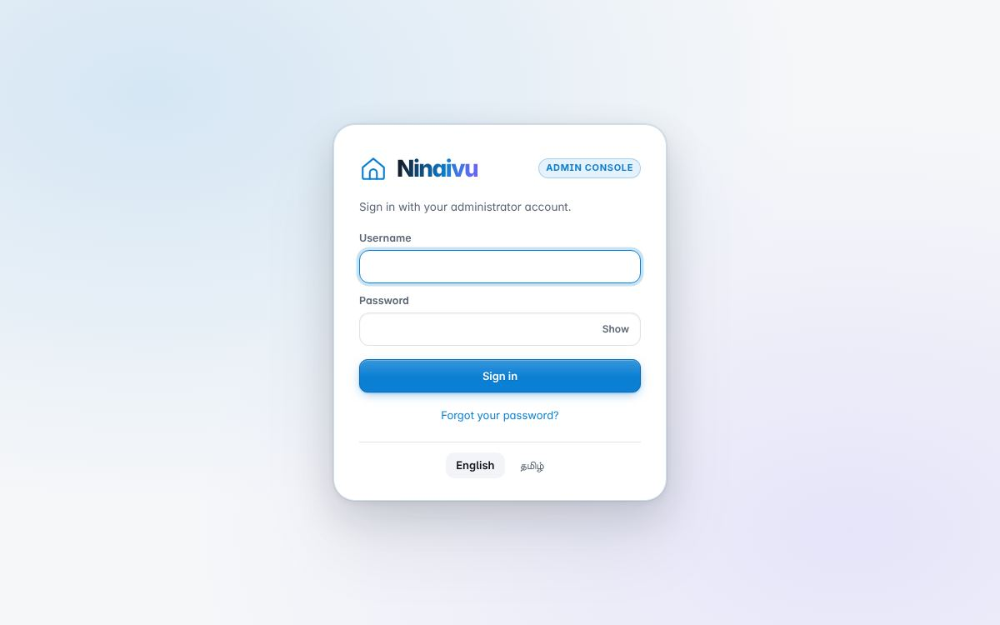

!!! note "இரண்டு செயலிகள், இரண்டு port-கள்"
    குடும்பச் செயலியும் நிர்வாக பலகையும் ஒரே process-இல் இயங்கும் இரண்டு செயலிகள்.
    நிர்வாக பலகையின் பாதைகள் (routes) குடும்பச் செயலியில் வெறுமனே தடுக்கப்படவில்லை —
    அவை *இல்லவே இல்லை*: நபர்கள், தெரிவுநிலை விதிகள், Import, Mugil, அமைப்புகள்
    ஆகியவை நிர்வாக பலகையின் port-இல் மட்டுமே உள்ளன. குடும்பச் செயலியில் உள்நுழைந்த
    ஒரு நிர்வாகி, படத்தொகுப்பிலிருந்தே புகைப்படங்களை நீக்கவும் அவற்றின் தெரிவுநிலையை
    மாற்றவும் இன்னும் முடியும். குடும்பச் செயலியில் உருவான ஒரு session —
    நிர்வாகியுடையதாக இருந்தாலும் — நிர்வாக பலகையைத் திறக்க முடியாது.

!!! tip "கட்டளைப் பலகை"
    Mac-இல் ⌘K, மற்றவற்றில் Ctrl+K (அல்லது மேல் பட்டையில் உள்ள கட்டளைப் பலகைப் பொத்தான்)
    நிர்வாக பலகையின் எந்தப் பக்கத்தையும், அவற்றில் உள்ள அன்றாட வேலைகளையும்
    கண்டுபிடிக்கும்: **Rescan all**, **Add a folder**, **Add someone**, **Look for
    faces**, **Back up now**, **Check every file** போன்றவை, ஒவ்வொன்றும் அதன் பக்கத்தின்
    பெயருடன். அது அந்தப் பக்கத்தைத் திறந்து உங்களுக்காகப் பொத்தானை அழுத்தும்; ஆகவே
    பக்கத்தின் சொந்தக் கேள்விகள் முதலில் வரும். அழிப்பது, நகர்த்துவது, மறுதொடக்கம்
    செய்வது எதுவும் இதில் இல்லை. உங்கள் கணக்கு பயன்படுத்தக்கூடிய பக்கங்களும்
    வேலைகளும் மட்டுமே காட்டப்படும்.

## முகப்பு — Overview (மேலோட்டம்)

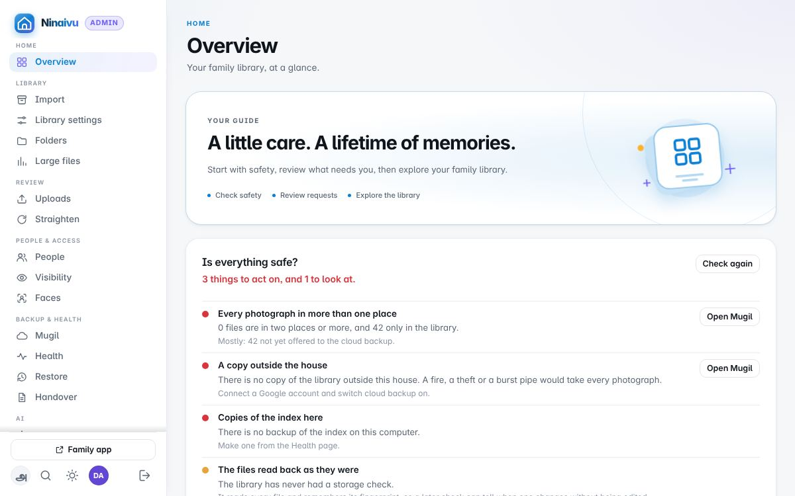

முதல் திரை எல்லாவற்றுக்கும் முன் இரண்டு கேள்விகளுக்குப் பதில் சொல்கிறது.
**Is everything safe?** (எல்லாம் பாதுகாப்பாக இருக்கிறதா?) குடும்பத்தின் பாதுகாப்புச்
சோதனைகளை இயக்குகிறது — வீட்டுக்கு வெளியே ஒரு நகல், மீட்டெடுக்கக்கூடிய ஒரு
காப்புப்பிரதி, அட்டவணையின் நகல்கள், நலமான வட்டுகள் — ஒவ்வொன்றுக்கும் என்ன செய்ய
வேண்டும் என்றும் சொல்கிறது. **Needs you** (உங்கள் கவனம் தேவை) ஒருவருக்காகக்
காத்திருப்பவற்றை எண்ணுகிறது: ஒப்புதலுக்கான பதிவேற்றங்கள், பெயரில்லாத முகங்கள்,
பக்கவாட்டில் சாய்ந்திருக்கக்கூடிய புகைப்படங்கள், தவறாகப் போனவை. பிறகு எண்ணிக்கைகள்,
ஒவ்வொரு பங்கும் உண்மையில் என்ன பார்க்கும் என்பது. [முதல் நாள்](first-day.md) ஒருமுறை
திறப்பதும் Overview-இல்தான்.

## Library (நூலகம்)

### Import (இறக்குமதி)

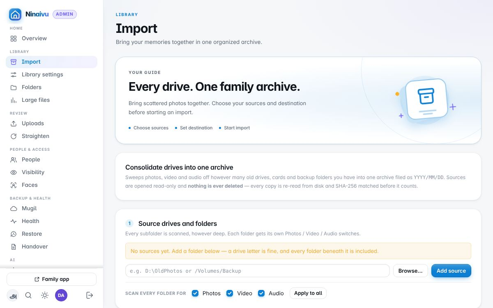

இது வேண்டுமென்றே முதல் Library பக்கம்: ஒரு நூலகம் பொதுவாகப் பழைய வட்டுகள், memory
card-கள், காப்புப்பிரதிக் கோப்புறைகளில் இருந்துதான் தொடங்குகிறது — அவை `YYYY/MM/DD`
என்ற அமைப்பில் ஒரே காப்பகமாக (archive) திரட்டப்படுகின்றன. உள்ளே வரும்போதே ஒவ்வொரு
கோப்புக்கும் hash கணக்கிடப்பட்டு, நகல் சரியா என்று மீண்டும் படித்துச் சரிபார்க்கப்படுகிறது;
நகல்கள் (duplicates) உள்ளடக்கத்தை வைத்து அடையாளம் காணப்பட்டு, அப்படியே விடப்பட்டு,
பதிவு செய்யப்படுகின்றன; மூலங்கள் படிக்கப்பட மட்டுமே செய்யும். **Dry run** எல்லாவற்றையும்
தீர்மானிக்கும், எதையும் எழுதாது. **Start consolidation** தொடரவும் செய்யும்: இடையில் நின்ற ஓட்டம்
நின்ற இடத்திலிருந்தே தொடரும். 60 KB-க்குக் குறைவான கோப்புகள் — icons, thumbnails —
தொடப்படுவதில்லை.

**Plugged in now** (இப்போது இணைக்கப்பட்டுள்ளவை) நினைவு கணினியில் உள்ள ஒவ்வொரு டிரைவ்,
மெமரி கார்டு, தொலைபேசியையும் அதன் காலி இடத்துடனும், நினைவுக்கு அது என்ன என்பதுடனும்
பட்டியலிடும்: நூலகம் உள்ள டிரைவ், ஏற்கனவே மூலங்கள் உள்ள டிரைவ், இறக்குமதி நடக்கும் டிரைவ்.
**Use the whole drive** (முழு டிரைவையும் பயன்படுத்து) அதை மூலமாக்கும், **Choose a folder on it…**
(அதில் ஒரு கோப்புறையைத் தேர்ந்தெடு) அங்கேயே கோப்புறைத் தேர்வியைத் திறக்கும், **Eject**
(வெளியேற்று) அதைப் பாதுகாப்பாகப் பிரிக்க விடுவிக்கும் (நூலகத்தின் சொந்த டிரைவை அல்ல,
இறக்குமதி அல்லது நகலெடுப்பு அதைப் பயன்படுத்தும்போதும் அல்ல). கன்சோல் திறந்திருக்கும்போது
இணைக்கப்படும் டிரைவுக்கு மேலே ஓர் அறிவிப்பு வரும்; அதில் உள்ள கோப்புறைகள் ஏற்கனவே
மூலங்களாக இருந்தால், அதிலிருந்து இறக்குமதி செய்வது முழு டிரைவையும் அவற்றின் அருகே
சேர்க்காமல் அந்தக் கோப்புறைகளையே வைத்திருக்கும். இணைக்கப்படாத டிரைவில் உள்ள சேருமிடம்
அல்லது மூலம், கணினியின் சொந்த வட்டில் எழுதப்படாமல், அந்த டிரைவின் பெயருடன் மறுக்கப்படும்.

மெதுவான வட்டில் முழு வட்டையும் எண்ண நிமிடங்கள் ஆகும், ஆகவே கேட்கும்போது மட்டுமே
எண்ணப்படும். **Count files** (கோப்புகளை எண்ணு) நகலெடுக்காமல் வட்டைப் பார்வையிட்டு
ஓட்டம் என்ன செய்யும் என்று சொல்லும்; **Start consolidation** முதலில் எண்ணி, பின்
நகலெடுக்கும், அதே கோப்புறைகளின் எண்ணிக்கை ஏற்கனவே நடந்தால் மீண்டும் எண்ணாமல்
அதிலிருந்தே தொடரும். எண்ணிக்கை சொல்வது: எத்தனை கோப்புகள் கிடைத்தன, அவற்றில் எத்தனை புதியவை,
எத்தனை ஏற்கனவே காப்பகத்தில் உள்ளன, புதியவற்றுக்கு எவ்வளவு இடம் தேவை, அவற்றை
நகலெடுக்கச் சுமார் எவ்வளவு நேரம் ஆகும் (ஒரு ஓட்டம் முடிந்த பிறகு, அதன் வேகத்தை
வைத்து), மற்றும் எவை தடுத்து வைக்கப்பட்டன — பாடநெறிக் கோப்புறைகள், திரைப்படங்கள்,
TV, இசை — அவற்றைக் கீழே முடிவு செய்யலாம். முடிந்த எண்ணிக்கை பன்னிரண்டு மணி நேரம்,
மறுதொடக்கத்துக்குப் பிறகும், ஓட்டம் எதையாவது நகலெடுக்கும் வரை வைக்கப்படும்;
திரைப்படம் அல்லது இசைக் கோப்புறையை வைத்துக்கொள்வதும் விடுவதும் மீண்டும் எண்ணாமலே
அதைச் சரிசெய்யும். Dry run, நகலாக இருக்கக்கூடிய
கோப்புகளை மட்டுமே படிக்கும்; ஆகவே பெரிய வட்டிலும் விரைவானது. காலி இடச் சோதனை
புதிய கோப்புகளை மட்டுமே கணக்கிடும்: இரண்டாம் முறை கொண்டு வரும் வட்டில்
பெரும்பாலானவை தாண்டிச் செல்லப்படும் கோப்புகளே. சேருமிடத்தில் இடம் போதாது என்று
தோன்றினாலும் **Continue anyway** (எப்படியும் தொடரவும்) ஓட்டத்தைத் தொடங்கும்; வட்டு
உண்மையிலேயே நிரம்பினால் ஓட்டம் *the archive drive is full* என்று நின்று, இதுவரை
நகலெடுத்த அனைத்தையும் வைத்திருக்கும். ஒரே நேரத்தில் சில கோப்புகள் நகலெடுக்கப்படும்
(Library-இல் **import_copy_workers**; 1 என்றால் ஒவ்வொன்றாக); முடிவுகள் இன்னும் ஒரு
கோப்புக்குப் பின் ஒன்றாகவே எடுக்கப்படுவதால், ஒரே மாதிரியான புகைப்படங்கள் ஒருமுறையே
சேமிக்கப்படும், dry run சொல்வதையே ஓட்டம் எழுதும்.

யார் பார்த்தாலும் வட்டு ஒருமுறையே பார்வையிடப்படும். வேறு திரைக்குச் சென்று
திரும்பினாலோ, பக்கத்தை refresh செய்தாலோ
இரண்டாவது tab-இல் திறந்தாலோ, எண்ணிக்கை மீண்டும் தொடங்காமல் எங்கிருந்ததோ
அங்கிருந்தே தொடரும், முடிந்த எண்ணிக்கை உடனே மீண்டும் காட்டப்படும்; பக்கம்
மூடப்பட்ட எண்ணிக்கை தானாகவே நின்றுவிடும். **Start**
அல்லது **Dry run** அழுத்தியதும் ஓட்டத்தின் சொந்த எண்ணிக்கையே ஒரே எண்ணிக்கை:
சேருமிடத்தின் கீழுள்ள வரி மறைந்து, ஓட்ட அட்டை இதுவரை எத்தனை கோப்புகள் கிடைத்தன,
அவற்றின் அளவு, எவ்வளவு நேரமாக எண்ணுகிறது, எந்தக் கோப்புறையில் உள்ளது என்று
சொல்லும்.

நினைவோ கணினியோ restart ஆனதால் இடையில் நின்ற இறக்குமதி, நினைவு திரும்பியதும் தானாகவே
தொடரும்; பக்கமும் activity strip-உம் *resuming after restart* (restart-க்குப் பின்
தொடர்கிறது) என்று, ஏற்கனவே எத்தனை கோப்புகள் முடிந்தன என்பதோடு சொல்லும்; எண்ணிக்கை
இதுவரை கண்ட கோப்புகளைக் காட்டும். நிர்வாக பலகையை refresh செய்தால் திறந்திருந்த
பக்கத்திலேயே இருக்கும், ஆகவே எண்கள் தொலைவதில்லை.

தற்காலிகக் காரணத்தால் தோல்வியடையும் கோப்பு (sync செயலி இன்னும் எழுதிக்கொண்டிருப்பது,
வேறொரு நிரலில் திறந்திருப்பது, மெதுவாகப் பதில் அளிக்கும் வட்டு) மற்றவை முடிந்த 30
வினாடிகளுக்குப் பின் இன்னொரு முறை முயலப்படும். அப்போதும் தோல்வியடைபவை **Errors**
(பிழைகள்) பட்டியலில், முதலில் எளிய சொற்களில் காரணத்துடன் இருக்கும்: கோப்பு பூட்டப்பட்டிருந்தது
அல்லது நினைவுக்கு Full Disk Access தேவை, கோப்பு காணாமல் போனது, வட்டு படிப்புப் பிழை
சொன்னது, காப்பக வட்டுக்குப் பெயர் மிக நீளம், FAT32 வட்டு ஏற்கும் அளவை விடப் பெரிய கோப்பு.
**Retry failed** (தோல்வியடைந்தவற்றை மீண்டும் முயல்), அல்லது அடுத்த Start, அவற்றை மீண்டும்
முயலும். கேமரா அல்லது dashcam தன் card-இல் பாதுகாத்த clip-கள் (Mac-இல் பூட்டப்பட்டவை)
மற்ற கோப்புகள் போலவே நகலெடுக்கப்படும்; நகல் பூட்டப்படுவதில்லை, card அப்படியே இருக்கும்.
காப்பக வட்டு நிரம்பினால், இறக்குமதி *the archive drive is full* என்று சொல்லி நிற்கும்,
நகலெடுத்துச் சரிபார்த்தவற்றை வைத்துக்கொள்ளும், இடம் கிடைத்ததும் Start அழுத்தினால் தொடரும்.

ஓட்டம் முடிந்ததும் பக்கம் **add the archive to the library** (காப்பகத்தை நூலகத்தில்
சேர்) என்று வழங்கும். Google Photos Takeout ஏற்றுமதி முழுமையாக வந்து சேரும்: அதன்
sidecar கோப்புகள் தேதிகள், இடங்கள், விவரணைகளைத் தருகின்றன; காப்பகம் அட்டவணைப்படுத்தப்பட்ட
பின், அது வைத்திருந்த நகல்களிலிருந்து **make its albums** (அதன் ஆல்பங்களை உருவாக்கு)
என்று பக்கம் வழங்கும். **Archive Guardian** (காப்பகக் காவலர்) ஒவ்வொரு நாளும்
காப்பகக் கோப்புகளின் சுழலும் மாதிரியை மீண்டும் படித்து, எதாவது மாறியிருந்தால் சொல்லும்.

### Library settings (நூலக அமைப்புகள்)

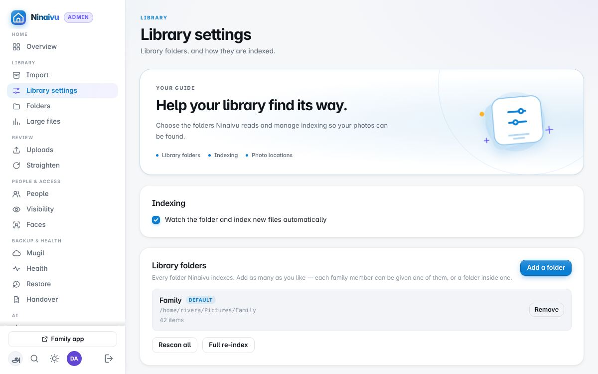

எந்தக் கோப்புறைகள் நூலகத்தை உருவாக்குகின்றன, அவை எப்படி அட்டவணைப்படுத்தப்படுகின்றன:
மாற்றங்களுக்காக நினைவு அவற்றைக் கவனிக்கிறதா, மறைக்கப்பட்ட கோப்புகள்
அட்டவணைப்படுத்தப்படுகின்றனவா, ஸ்கேன் தானாக என்ன கண்டுபிடிக்கிறது. எத்தனை கோப்புறைகளை
வேண்டுமானாலும் சேர்க்கலாம்; இணைப்பு நீக்கப்பட்ட ஒரு வட்டில் உள்ள கோப்புறை நூலகக்
கோப்புறையாகவே இருக்கும்; எதுவும் காட்டாமல் இருப்பதற்குப் பதிலாக படத்தொகுப்பு அதைச்
சொல்லும். மீண்டும் இணைக்கப்பட்டதும், மறுதொடக்கம் இல்லாமலே, கால் நிமிடத்துக்குள் அது
மீண்டும் கவனிக்கப்பட்டு அதில் மாறியவை படிக்கப்படும். Mac அதைப் புதிய பெயரில் ("SSD 1")
இணைத்தால், கன்சோல் அதன் குறியைக் கொண்டு அதில் நூலகத்தைக் கண்டுபிடித்து, அதுதான் நூலகமா
என்று கேட்கும் (காப்புப்பிரதி நகலும் அதே குறியைக் கொண்டிருக்கும்); **Use** (பயன்படுத்து),
பிறகு **Restart now** (இப்போதே மீண்டும் தொடங்கு) அழுத்தினால் நூலகம் அதன் ஆல்பங்கள்,
பெயர்கள், சிறுபடங்களுடன் அங்கு நகரும்.

**தேதிகள் எங்கிருந்து வருகின்றன:** முதலில் camera-வின் சொந்தத் தேதி, பிறகு container-இன்
metadata, பிறகு Takeout sidecar, பிறகு கோப்புப் பெயரில் உள்ள தேதி, பிறகு
`YYYY/MM/DD` கோப்புறைப் பாதை, அதன் பின்னரே கோப்பின் சொந்த creation அல்லது
modification time. எது பயன்படுத்தப்பட்டது என்று புகைப்படக் காட்சியின் விவரங்கள்
பகுதி சொல்லும்.

ஒரு நூலகக் கோப்புறையில் எழுத முடியாதபோது — உதாரணமாக Mac-இல் ஒரு NTFS வட்டு —
திருத்தப்பட்ட நகல்கள், ஒப்புக்கொள்ளப்பட்ட பதிவேற்றங்கள், கைப்பேசிக் காப்புப்பிரதிகள்
`~/Pictures/Ninaivu`-க்குச் செல்லும்; முதல் பயன்பாட்டிலேயே அது நூலகத்தில் சேரும்.

### Folders (கோப்புறைகள்)

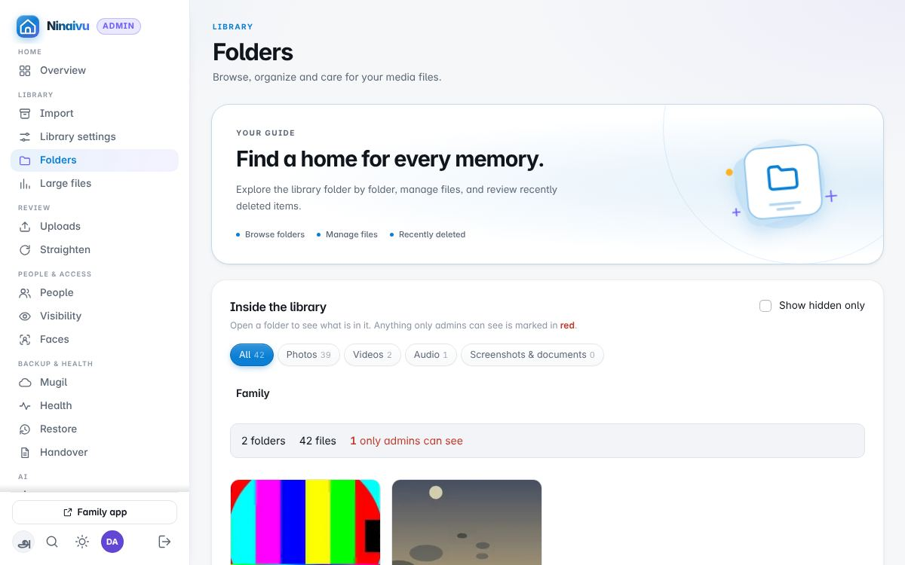

நூலகம் கோப்புறைகளாக — ஒவ்வொன்றிலும் என்ன உள்ளது, ஒவ்வொரு கோப்புறையின் தெரிவுநிலை —
மற்றும் **recycle bin** (குப்பைத் தொட்டி).

**மறைக்கப்பட்டவை, வெளிப்படையானவை (explicit) உட்பட ஒவ்வொரு கோப்பும் இங்கே காட்டப்படும்**;
அவற்றைச் சரிபார்க்கும் இடம் இதுவே. வெளிப்படையானது (explicit) என்பது வயதுவந்தோர் உள்ளடக்கம்
மட்டுமே; திரைப்பிடிப்புகளும் ஆவணங்களும் மறைக்கப்பட்டவை, வெளிப்படையானவை அல்ல. மறைக்கப்பட்டது அல்லது வெளிப்படையானது எனக் குறிக்கப்பட்டது
எதுவும், யார் உள்நுழைந்தாலும், குடும்பச் செயலிக்குச் செல்லாது.

- **ஒரு கோப்பைத் திறந்தால்** முழு அளவில் தெரியும் (வீடியோ இயங்கும்); அம்புகளால் கோப்புறை
  முழுவதும் நகரலாம்; அங்கேயே **Hide** (மறை, நிர்வாகிகளுக்கு மட்டும்) அல்லது **Show to
  family** (குடும்பத்துக்குக் காட்டு), **Mark explicit** அல்லது **Not explicit**, **Delete**
  (ஒரு உறுதிப்படுத்தலுடன், கடவுச்சொல் இன்றி, குப்பைத் தொட்டிக்கு; Recently deleted திரும்ப வைக்கும்), நினைவு கணினியிலேயே என்றால் **Show in Finder or
  Explorer**. **Change the date** கோப்பை அதன் ஆண்டு/மாதம்/நாள் கோப்புறைக்கு நகர்த்தும்.
- **உலாவியில் இயங்காத வீடியோக்கள்** (பழைய தொலைபேசிகளின் 3GP, MKV, AVI, WMV போன்றவை)
  நினைவு ஒருமுறை மாற்றும் நகலிலிருந்து இயங்கும்; நகல் உருவாகும்போது ஒரு பட்டை தெரியும்;
  மூலக் கோப்பு மாறாது. **Download** மூலக் கோப்பை நீங்கள் இருக்கும் கணினியில் சேமிக்கும்.
- **நினைவு கணினியிலேயே** இருந்தால், ஒவ்வொரு கோப்பின் வட்டு இடமும் அதன் கீழ் எழுதப்படும்;
  மேலே உள்ள **Show in Finder or Explorer** நீங்கள் இருக்கும் கோப்புறையைத் திறக்கும்.
  வேறு சாதனத்திலிருந்து இவை காட்டப்படாது.
- பல கோப்புகளுக்கு ஒரே நேரத்தில் செய்ய, **கோப்புகளைத் தேர்வு செய்யுங்கள்** (அல்லது **Choose all**).
- சில்லுகள் புகைப்படம், வீடியோ, ஒலி, திரைப்பிடிப்பு, **Hidden** அல்லது **Explicit** (ஏதாவது
  குறிக்கப்பட்டிருந்தால்) எனச் சுருக்கும். Hidden, Explicit இரண்டும் திறந்த கோப்புறைக்குள்
  உள்ள ஒவ்வொரு கோப்புறையிலும் தேடும்; மற்றவற்றுக்கு **Include files in folders inside**
  அதையே செய்யும். நீண்ட கோப்புறைகள் ஒரு முறைக்கு 200 கோப்புகள், **Show more** உடன்.
- கோப்புகளுக்கு மேலே உள்ள பட்டை, கோப்புறை மறைக்கப்பட்டதா எனச் சொல்லும். **Hide this folder**
  அதையும், பின்னர் சேர்க்கப்படுவதையும் நிர்வாகிகளுக்கு மட்டும் ஆக்கும். **Stop hiding this
  folder** அந்த விதியை நீக்கி, மேலே உள்ள விதிகள் சொல்வதுபடி கோப்புகளைத் திருப்பும் (முதலில்
  கேட்கும்; Visibility பக்கத்தில் செயல்தவிர்க்கலாம்); ஒவ்வொன்றாக மறைத்தவை மறைந்தே இருக்கும்.
  மேலே உள்ள கோப்புறையால் மறைக்கப்பட்டிருந்தால், எது என்று சொல்லி, அதைத் திறக்கும் பொத்தானும் தரும்.
 நினைவில் நீக்கினால், கோப்பு நூலகத்தின்
அருகே உள்ள `_deleted` கோப்புறைக்குச் செல்லும்; அங்கிருந்து அதன் முகங்கள், ஆல்பங்கள்
அப்படியே இருக்கத் திரும்ப வைக்கலாம். இங்கே குப்பைத் தொட்டியைக் காலி செய்தால் (அது
முதலில் கேட்கும்) அல்லது Advanced settings-இல் நாட்களின் எண்ணிக்கையை அமைத்தால் தவிர,
எதுவும் நிரந்தரமாக அழிக்கப்படாது.

### Large files (பெரிய கோப்புகள்)

அதிக இடத்தை எடுத்துக்கொள்ளும் கோப்புகள் — ஒருமுறை பார்த்து, reviewed (பார்த்தாயிற்று)
எனக் குறிக்க.

வேண்டிய கோப்புகளைத் தேர்ந்தெடுத்து (அல்லது *Choose all*) பட்டியலின் மேலே உள்ள பொத்தான்களைப் பயன்படுத்துங்கள்.
காணொளிகளுக்கு **Compress & Replace** (சுருக்கி மாற்று) ஒரே படியில் சிறிய MP4 நகலை
உருவாக்கி, அது சரியாக இயங்குகிறதா எனச் சரிபார்த்த பின் மூலத்தின் இடத்தில் வைக்கும்;
மூலம் `_deleted/_originals`-இல் பாதுகாக்கப்படும். அது முதலில் உங்கள் கடவுச்சொல்லைக் கேட்கும்.
அதற்கு ffmpeg தேவை; அது இல்லையெனில் பொத்தான் சாம்பல் நிறத்தில் இருக்கும்.

## Review (மதிப்பாய்வு)

### Uploads (பதிவேற்றங்கள்)

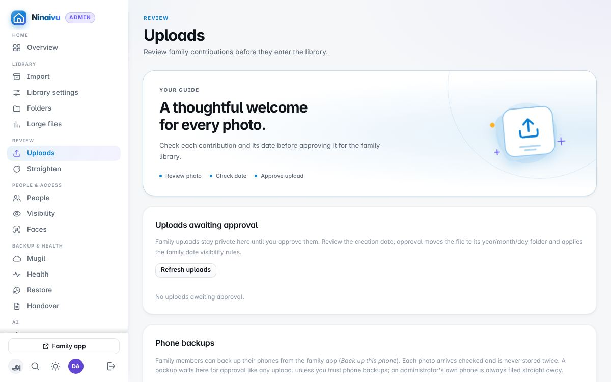

குடும்பத்தினர் தங்கள் கைப்பேசிகளிலிருந்து அனுப்பிய புகைப்படங்களும், சுடரில் சேமிக்கப்பட்ட
திருத்தங்களும், நூலகத்தில் சேர்க்கவோ மறுக்கவோ காத்திருக்கின்றன; காப்புப்பிரதி
அனுப்பிய கைப்பேசிகளும் இங்கே. **Trust phone backups** என்பதைத் தேர்ந்தெடுக்காவிட்டால்,
ஒரு குடும்ப உறுப்பினர் அனுப்பும் எதுவும் இங்கே கடக்காமல் நூலகத்தில் சேராது;
நிர்வாகியின் சொந்தக் கைப்பேசி மதிப்பாய்வைத் தவிர்க்கும்.

### Straighten (நேராக்கு)

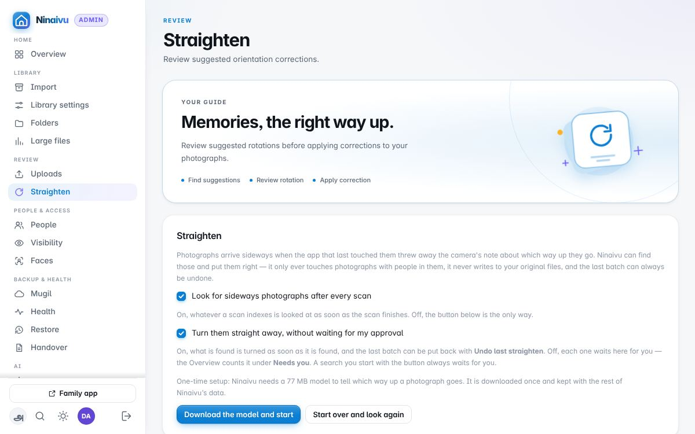

பக்கவாட்டில் சாய்ந்திருப்பதாக model நினைக்கும் புகைப்படங்கள் — மிக உறுதியான ஊகம்
முதலில் — ஒவ்வொன்றும் திருத்திய பின் இருக்கப்போகும் விதத்திலேயே காட்டப்படும். ஒன்றைத்
தவிர்க்க அதைச் சொடுக்குங்கள்; **Straighten them** மீதமுள்ளவற்றை ஒரே தொகுதியாகத்
திருப்பும். இது கால் சுற்றை (quarter
turn) மட்டுமே பரிந்துரைக்கும்; இயல்பாக, ஒரு நபர் உள்ள புகைப்படங்களுக்கு மட்டும் —
கண்டுபிடிக்கப்பட்ட முகம், இந்தப் பக்கம்தான் மேல் என்பதற்கு இரண்டாவது சாட்சி.
இயல்பாக, ஒவ்வொரு ஸ்கேனுக்குப் பிறகும், ஸ்கேன் அட்டவணைப்படுத்தியவற்றின் மேல் இந்தப்
பார்வை தானாகவே நடக்கும்; அது கண்டுபிடிப்பவை உடனே, ஒரே தொகுதியாகத்
திருப்பப்படும். **Undo** கடைசித் தொகுதியை — thumbnails உட்பட — அப்படியே திரும்ப
வைக்கும். மேலே உள்ள இரண்டு switch-கள் இதை மாற்றும்: ஒன்று தானாகப் பார்ப்பதை
அணைக்கும், பொத்தான் மட்டும் இருக்கும்; மற்றொன்று, கண்டுபிடிப்பவற்றைத் திருப்பாமல்
இங்கே ஒப்புதலுக்காக வைத்திருக்கும். பொத்தானால் தொடங்கும் தேடல் எப்போதும் உங்களுக்காகக்
காத்திருக்கும்.

## People & access (நபர்களும் அணுகலும்)

### People (நபர்கள்)

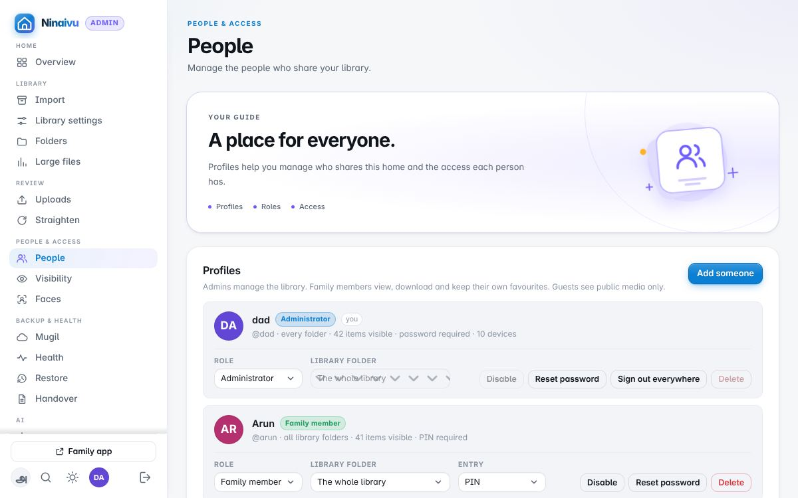

குடும்பத்தின் சுயவிவரங்கள்: ஒரு நிர்வாகி, குடும்ப உறுப்பினர்கள், விருந்தினர்கள்.
ஒவ்வொருவருக்கும் ஒரு பங்கு, உள்ளே வரும் ஒரு வழி (PIN, கடவுச்சொல், அல்லது ஒரு தொடுதல்),
விருப்பமாக அவருக்கே உரிய ஒரு கோப்புறை — எந்த நூலகக் கோப்புறையும், அல்லது அதற்குள்
உள்ள எந்தக் கோப்புறையும். ஒதுக்கீடும் தெரிவுநிலையும் ஒன்றின் மேல் ஒன்று அடுக்கப்படும்;
எப்போதும் குறுகியதே வெல்லும்: ஒரு கோப்புறை கொடுக்கப்பட்ட விருந்தினர் கூட, அதில்
பொதுவானதை மட்டுமே பார்ப்பார்.

**Disable** (முடக்கு) திரும்பப் பெறக்கூடியது, அந்த நபரின் பிடித்தவைகளை வைத்திருக்கும்;
**delete** (நீக்கு) இறுதியானது — சுயவிவரம், அதன் பிடித்தவை, திறந்திருக்கும் ஒவ்வொரு
session-ஐயும் நீக்கும். இரண்டுமே எந்தப் புகைப்படத்தையும் தொடாது. உங்களையோ கடைசி
நிர்வாகியையோ நீக்க முடியாது. ஒரு சுயவிவரத்தை முடக்குவதோ அதன் கடவுச்சொல்லை மீட்டமைப்பதோ,
எல்லா இடங்களிலும் அதன் session-களை ஒரே நேரத்தில் முடிக்கும்.

உள்நுழைவுத் திரையில் **கடவுச்சொல் மறந்துவிட்டதா?** அழுத்தியவர், புதிய கடவுச்சொல்
அல்லது PIN கிடைக்கும் வரை, இங்கேயும் Overview-இலும் *உள்நுழைய உதவி கேட்டுள்ளனர்* எனக்
குறிக்கப்படுவார். **Reset password** அவரிடம் சொல்ல ஒரு தற்காலிகக் கடவுச்சொல்லைக்
கொடுக்கும்; அடுத்த உள்நுழைவில் அவர் தம்முடையதைத் தேர்ந்தெடுப்பார். மீட்டமைக்க வேறு
நிர்வாகி இல்லாதபோது மறந்த நிர்வாகிக் கடவுச்சொல்லை, நினைவு இயங்கும் கணினியில் Control
Panel-இன் **Reset a password…** மூலம் அமைக்கலாம். [படிகள்.](troubleshooting.md)

### Visibility (தெரிவுநிலை)

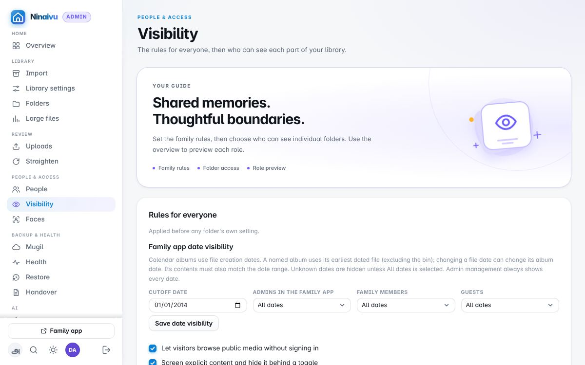

யார் எதைப் பார்க்கலாம். முதலில் அனைவருக்குமான விதிகள் — வருகையாளர்கள் உள்நுழையாமல்
உலாவலாமா, வெளிப்படையான உள்ளடக்கம் வடிகட்டப்பட வேண்டுமா, ஒவ்வொரு பங்கும் காலத்தில்
எவ்வளவு பின்னோக்கிப் பார்க்கலாம் — பிறகு ஒவ்வொரு கோப்புறையின் சொந்த அமைப்பு:
everyone (அனைவரும்), family (குடும்பம்), அல்லது admins only (நிர்வாகிகள் மட்டும்).
யாராவது வேறுவிதமாகச் சொல்லும் வரை, புதிய ஊடகம் *family* ஆகவே இருக்கும்; ஆகவே தற்செயலாக
எதுவும் விருந்தினரை அடையாது. ஒரு கோப்புறையின் அமைப்பு ஒரு விதியாக நினைவில்
வைக்கப்படுகிறது; பின்னர் அதில் ஸ்கேன் செய்யப்படும் கோப்புகளும் அதையே பெறும்.
ஒரு கோப்புறையை அமைப்பது அதன் கீழ் உள்ள அனைத்தையும் மாற்றி எழுதும்; ஆகவே முந்தைய நிலை
முதலில் எழுதி வைக்கப்படுகிறது, ஒவ்வொரு மாற்றத்தையும் ஒரே அடியில் திரும்பப் பெறலாம்.

### Faces (முகங்கள்)

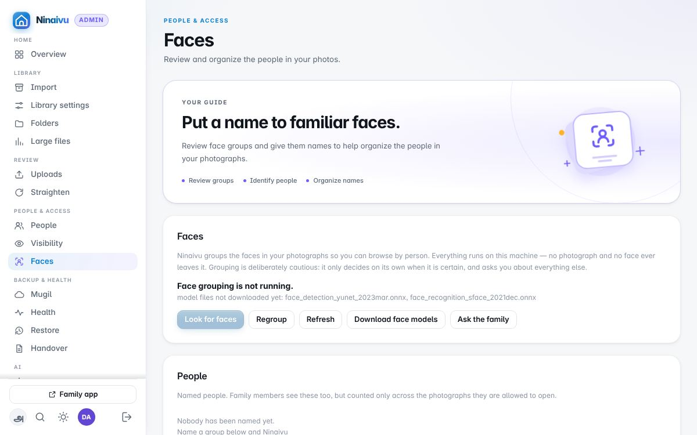

முகப் பொருத்தி கண்டுபிடித்த நபர்கள், குழுக்களாக. ஒரு முகத்துக்குப் பெயரிட்டால் அதன்
குழுவில் உள்ள மற்றவையும் பின்தொடரும்; பெயருக்காகக் காத்திருக்கும் குழுக்கள் விரைவாகக்
கடந்து செல்லப் பட்டியலிடப்பட்டுள்ளன. 50 pixel-க்குச் சிறிய முகங்கள் வேண்டுமென்றே
தவிர்க்கப்படுகின்றன — காட்டப்படுபவை நம்பகமாக இருப்பதற்கு அதுவே விலை. முகங்கள்
இந்தக் கணினியிலேயே கண்டுபிடிக்கப்பட்டுப் பொருத்தப்படுகின்றன; பெயர்கள் முகிலின்
மறையாக்கப்பட்ட அட்டவணை நகலுக்குள் மட்டுமே பயணிக்கின்றன.

## Backup & health (காப்புப்பிரதியும் நலமும்)

### Mugil (முகில்)

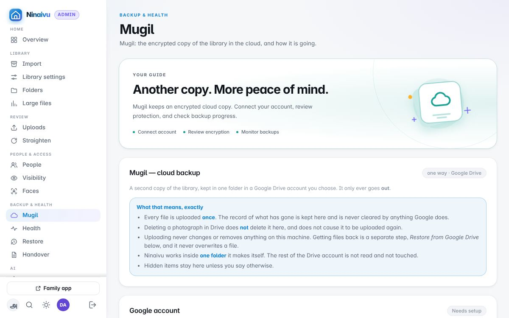

**முகில்** (Mugil): நூலகத்தின் மறையாக்கப்பட்ட நகல் Google Drive-இல் — கணக்கு,
மறையாக்க விசையும் அதன் மீட்பு கோப்பும் (விசை உருவாகும் வரை எதுவும் பதிவேற்றப்படாது),
எது அனுப்பப்படுகிறது, எது நிறுத்தி வைக்கப்படுகிறது, வேகமும் நேரமும், **Test restores**:
நகல் மீட்டெடுக்கிறதா என்பதற்கான வாராந்திரச் சோதனை, அதன் வரலாற்றுடன்.
[காப்புப்பிரதி பற்றி மேலும்.](backup.md)

### Health (நலம்)

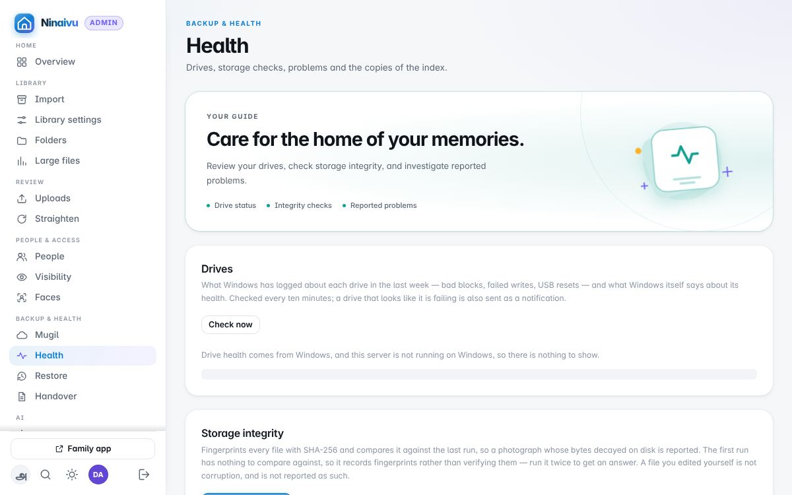

வட்டுகளும் அவற்றின் SMART நிலையும், ஒவ்வொரு கோப்பையும் அதன் கைரேகையுடன் (fingerprint)
ஒப்பிட்டு மீண்டும் படிக்கும் சேமிப்புச் சோதனை, கடைசித் தொடக்கத்துக்குப் பின் தவறாகப்
போனவை, இந்தக் கணினியில் வைக்கப்படும் அட்டவணையின் நகல்கள், ஏதாவது கவனம் தேவைப்படும்போது
குடும்பத்துக்கு எப்படித் தெரிவிக்கப்படுகிறது — email அல்லது webhook மூலம். பெரிய நூலகத்தில்
மணிக்கணக்கில் ஓடும் சேமிப்புச் சோதனை, புதிய புகைப்படங்கள் அட்டவணைப்படுத்தப்படும்போது
வழிவிட்டு, பிறகு தொடரும்.
**வாரம் ஒரு புகைப்படம்:** நீங்கள் தேர்ந்தெடுக்கும் காலையில், கடந்த ஒரு ஆண்டில் அதே
நாளின் மிகச் சிறந்த புகைப்படத்தை நினைவு தேர்ந்தெடுத்துக் குடும்பத்துக்கு email
அனுப்பும்; அனுப்பத் தகுந்தது எதுவும் இல்லாத நாளில் அமைதியாக இருக்கும்.

### Restore (மீட்டெடு)

cloud நகலிலிருந்து புகைப்படங்களை மூன்று படிகளில் திரும்பக் கொண்டு வருதல்: எதைக்
கொண்டுவருவது, எங்கே வைப்பது, மறையாக்க விசை. இங்கே எதுவும் ஏற்கனவே இருக்கும் ஒரு
கோப்பின் மேல் ஒருபோதும் எழுதாது.

## AI

### AI models (AI மாதிரிகள்)

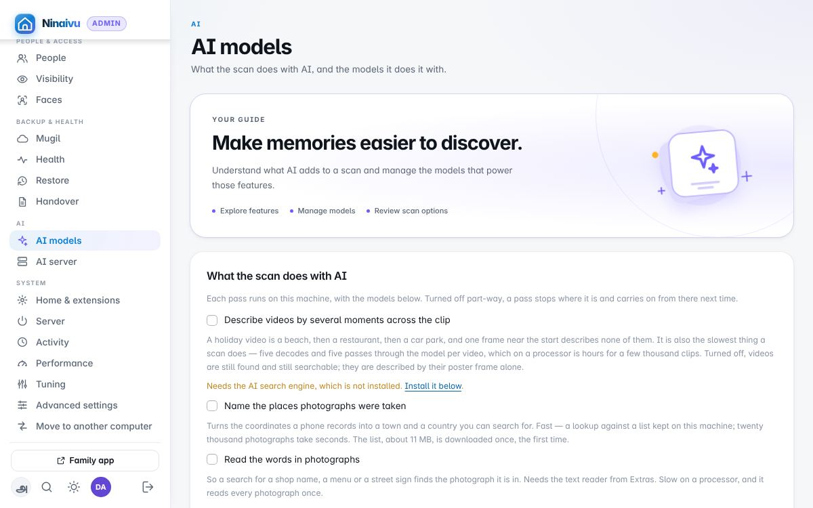

ஸ்கேன் AI-ஐக் கொண்டு என்ன செய்கிறது — இடங்களுக்குப் பெயரிடுதல், எழுத்துகளைப்
படித்தல், முகங்களைக் கண்டுபிடித்தல், காணொளிகளைப் பல தருணங்களால் விவரித்தல் —
ஒவ்வொரு switch-உம் அது எந்த model-ஐக் கேட்கிறது, அந்த model இங்கே இருக்கிறதா
என்று சொல்கிறது; பிறகு model-களே, அவற்றின் பதிவிறக்கங்களுடன். இந்தப் பக்கத்தில்
உள்ள அனைத்தும் இந்தக் கணினியிலேயே இயங்கும். [AI பற்றி மேலும்.](ai.md)

### AI server

ComfyUI இயக்கும் இரண்டாவது, வலிமையான கணினி உள்ள குடும்பத்துக்கு: கனமான வேலைகளை
அதனிடம் ஒப்படையுங்கள். இந்தப் பக்கம் Creative Studio நீட்சிக்கு உரியது; அது
இயக்கத்தில் இருக்கும்போது மட்டுமே தோன்றும்.

## System (அமைப்பு)

### Home & extensions (வீடு & நீட்டிப்புகள்)

இந்த வீட்டின் பெயரும் நினைவின் பதிப்பும்; நிறுவப்பட்ட **extensions** (நீட்சிகள்) —
ஒவ்வொன்றும் இயக்கத்தில் இருக்கும்போது என்ன செய்யும் என்று அதன் switch-இலேயே சொல்லும் —
வீட்டுக்கு வெளியே போகும் ஒரு நீட்சிக்குக் குடும்ப உறுப்பினர்கள் புகைப்படங்களை அனுப்பலாமா
என்பதும்; **Extras** — விருப்பத் தொகுப்புகள் (optional packages), விவரித்துத் தேடுதல்
(search by description) உட்பட.

### Server

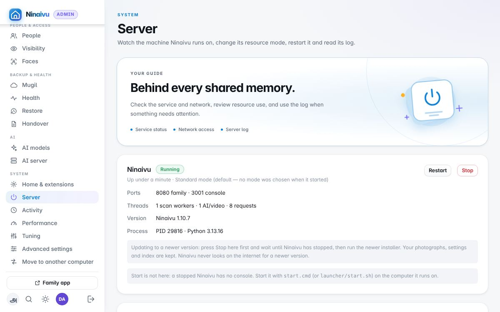

நினைவு இயங்குகிறதா, எங்கே பதில் அளிக்கிறது, அதன் பதிப்பு (புதிய பதிப்பை நிறுவும் முன் இங்கே **Stop** அழுத்துங்கள்),
குடும்பத்துக்குத் தர வேண்டிய முகவரிகள், **Away from home** (வீட்டுக்கு வெளியே) —
குடும்பம் வெளியிலிருந்து நினைவை எப்படி அடைகிறது ([வெளியிலிருந்து அணுகுதல்](remote-access.md)) —
**Network access**, நிர்வாக பலகையை வீட்டின் மற்ற சாதனங்களிலிருந்தும் திறக்கலாமா
என்பது (இணையத்திலிருந்து அது ஒருபோதும் திறக்காது; [வெளியிலிருந்து
அணுகுதல்](remote-access.md#home-and-the-internet) பாருங்கள்), resource mode (standard, performance, power-saving), restart, log, HTTPS
சான்றிதழ். Port-கள் இங்கே காட்டப்படுகின்றன; அவை நினைவு தொடங்கும்போது அமைக்கப்படுகின்றன
(`--port`, `--admin-port`).

### Activity (செயல்பாடு)

இப்போது என்ன இயங்குகிறது, யார் கணினியைப் பயன்படுத்துகிறார்கள் — ஆகவே காப்புப்பிரதியும்
ஸ்கேன்களும் குடும்பத்துக்கு வழிவிடலாம். **Balanced** காணொளி இயக்கத்துக்கு வழிவிடும்;
**quiet** யாராவது செயலியைப் பயன்படுத்தும்போதெல்லாம் காத்திருக்கும்; **overnight**
கனமான வேலையை இரவு நேரத்துக்கு வைத்து, அப்போது முழு வேகத்தில் இயக்கும்.

### Performance (செயல்திறன்)

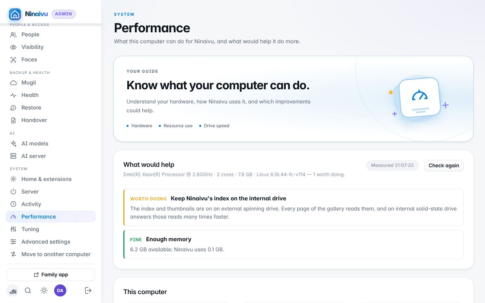

இந்தக் கணினி நினைவுக்கு என்ன செய்ய முடியும் — அது எந்த வகைக் கணினி
([Basic அல்லது Full](ai.md)), processor, நினைவகம், graphics, வட்டுகள், கடைசி ஸ்கேன்கள்
எவ்வளவு வேகமாக நடந்தன, என்ன காத்திருக்கிறது — மேலும் அதிகம் செய்ய எது உதவும்.

### Tuning (சீரமைப்பு)

நினைவு இந்தக் கணினியை எவ்வளவு கடுமையாக வேலை வாங்குகிறது. ஒவ்வொரு தொடக்கத்திலும்
processor, நினைவகம், graphics, வட்டுகளை அளந்து ஒரு profile-ஐத் தேர்ந்தெடுக்கும்:
**Small box** (சிறிய அல்லது குறைந்த திறன் கொண்ட கணினி), **Everyday computer**, அல்லது
**Powerful computer**. processor-இன் எல்லா cores-ஐயும், நினைவகத்தில் 95% வரையும் பயன்படுத்தும் **Peak
performance** கையால் மட்டுமே தேர்ந்தெடுக்கப்படும். அளக்கப்பட்டது என்ன, எண்கள் எவ்வளவு
பயன்படுத்தும் என்று எதிர்பார்க்கப்படுகிறது, ஒவ்வொரு எண்ணும் எங்கிருந்து வந்தது என்று
பக்கம் காட்டும்; ஒவ்வொன்றையும் மாற்றலாம், அல்லது தானியங்கிக்கு (automatic) திருப்பலாம்.
[விவரங்கள் (ஆங்கிலம்).](../../admin-guide.md#tuning-to-the-machine)

### Advanced settings (மேம்பட்ட அமைப்புகள்)

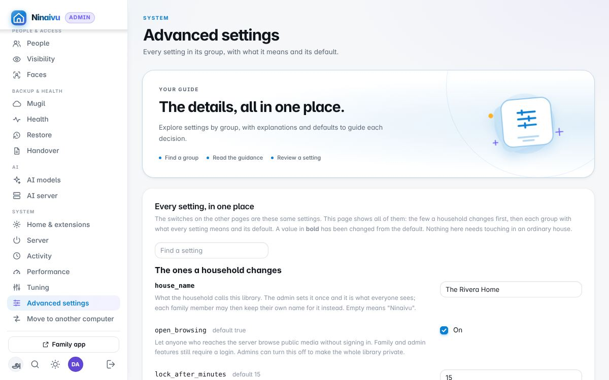

நினைவில் உள்ள ஒவ்வொரு அமைப்பும், ஆறு குழுக்களாக, ஒவ்வொன்றின் பொருளும் இயல்புநிலையும்
(default). மற்ற பக்கங்களில் உள்ள switch-கள் இதே அமைப்புகள்தான். ஒரு சாதாரண வீட்டில்
இங்கே எதையும் தொட வேண்டியதில்லை.

### Move to another computer (வேறொரு கணினிக்கு மாறு)

நினைவை நகர்த்துதல், அல்லது நூலகம் நகர்ந்துவிட்டது என்று அதற்குச் சொல்லுதல் —
எல்லாவற்றையும் மீண்டும் அட்டவணைப்படுத்தாமல்.
[விவரங்கள் (ஆங்கிலம்).](../../moving-to-another-machine.md)

## Command line

இந்த வழிகாட்டியில் எதற்கும் terminal தேவையில்லை: நிறுவிகளும், Control Panel-உம்,
நிர்வாக பலகையும் அனைத்தையும் செய்கின்றன. Command-line options, பராமரிப்புக்
கட்டளைகள் (அட்டவணையின் நகல், மீட்டெடுத்தல், மறந்துபோன நிர்வாகிக் கடவுச்சொல்லுக்குப்
புதியது), environment variables ஆகியவை
[தொழில்நுட்ப நிர்வாகி வழிகாட்டியில்](../../admin-guide.md) உள்ளன (ஆங்கிலத்தில்).
